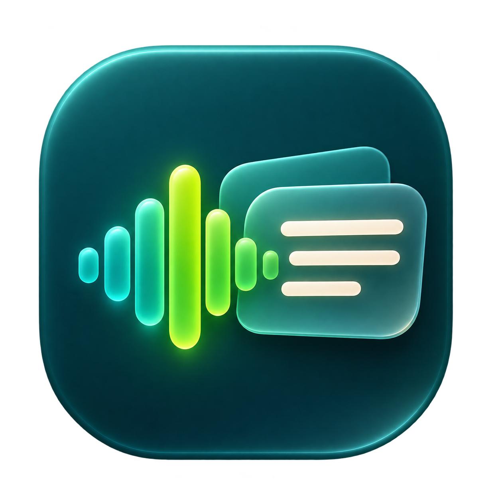
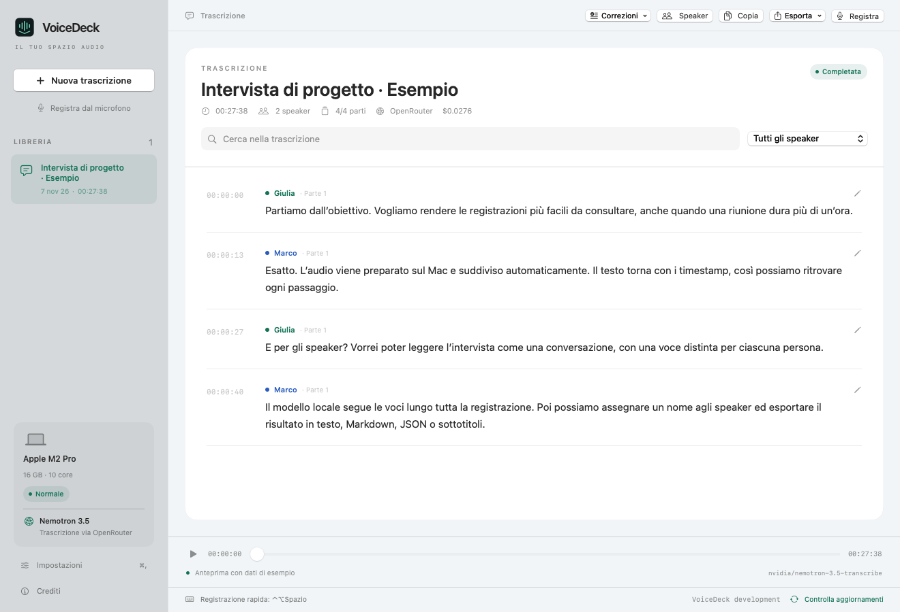
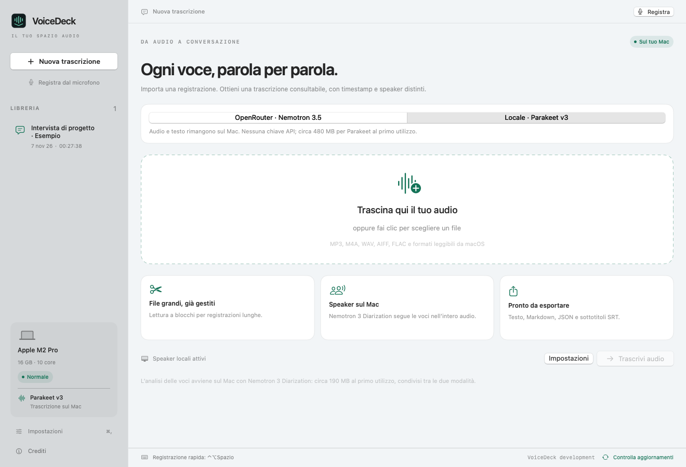
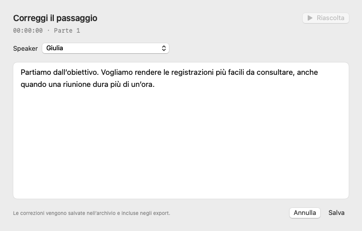
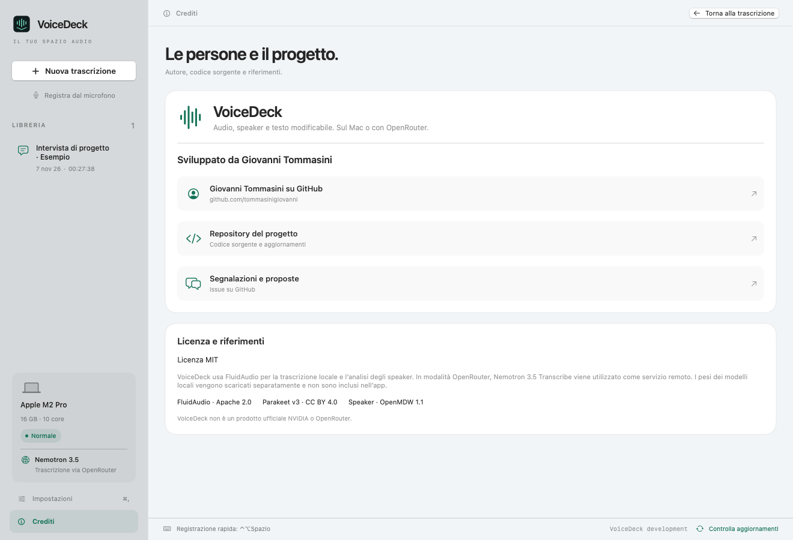

# VoiceDeck

**Audio, speaker e testo modificabile. Sul Mac o con OpenRouter.**

App nativa macOS in SwiftUI per trascrivere registrazioni, distinguere le voci e correggere il testo riascoltando il punto originale.



## Due modalità

| Modalità | Trascrizione | Speaker | Connessione |
| --- | --- | --- | --- |
| **Locale** | NVIDIA Parakeet TDT 0.6B v3 via Core ML | Nemotron 3 Diarization sul Mac | Solo per scaricare i modelli |
| **OpenRouter** | `nvidia/nemotron-3.5-transcribe` | Nemotron 3 Diarization sul Mac | Chiave e credito OpenRouter |

La modalità locale funziona offline dopo il download iniziale, senza costi API e senza inviare audio a servizi remoti. I modelli usano la cache condivisa FluidAudio: circa **480 MB** per Parakeet v3 e **190 MB** per gli speaker. In modalità OpenRouter, l’audio viene inviato al provider scelto dal servizio.

Richiede **macOS 14+**; Apple Silicon per la modalità locale. Build e inferenza locale verificate su un Mac con 16 GB di memoria.

## Funzioni

- Importazione con drag and drop o selettore file: MP3, M4A, WAV, AIFF, FLAC e formati leggibili da macOS.
- File grandi divisi automaticamente vicino ai silenzi, sotto il limite di 25 MB per richiesta OpenRouter anche dopo Base64.
- Un’unica analisi locale mantiene gli speaker coerenti lungo tutte le parti, fino a otto voci.
- **Clic sul testo o sul timestamp** per riascoltare quel punto dell’audio originale.
- **Matita** per correggere testo e speaker. I timestamp restano invariati e il testo iniziale del modello è conservato nel JSON.
- Speaker rinominabili e unificabili, ricerca nel testo e filtro per voce.
- Export TXT, Markdown, JSON e SRT con le correzioni applicate.
- Archivio locale, salvataggio dopo ogni parte e ripresa dopo errori, interruzioni o riavvio.
- Chiave OpenRouter nel Portachiavi macOS.
- Icona nella barra dei menu con importazione, apertura della finestra, avanzamento, interruzione e impostazioni. Chiudere la finestra mantiene l’app disponibile; usa **Esci** o Cmd-Q per terminarla.
- Registrazione dal microfono con pulsante e scorciatoia globale, anche con un’altra app attiva. Trascrizione e copia negli appunti alla fine della registrazione.
- Dizionario personale con grafie corrette e varianti per nomi, aziende e termini tecnici; suggerimenti da rivedere prima di applicarli.
- Footer fisso con versione e **Controlla aggiornamenti**, con download delle nuove release da GitHub.
- Riquadro Mac nella sidebar con chip, memoria, core, condizioni del sistema e modalità della trascrizione. Grafica chiara e scura nello stile di ModelDeck, con le azioni separate dalla barra del titolo.



## Utilizzo

1. Apri **VoiceDeck.app** e importa una registrazione.
2. Scegli **Locale · Parakeet v3** oppure **OpenRouter · Nemotron 3.5**. Solo per OpenRouter, inserisci la chiave in Impostazioni e premi **Salva nel Portachiavi**.
3. Premi **Trascrivi audio**. Al primo uso locale l’app scarica e prepara i modelli.
4. Fai clic su un passaggio per riascoltarlo; usa la matita per correggerlo. Dal pulsante **Speaker** puoi assegnare nomi alle voci.
5. Copia il testo o usa **Esporta**.



### Registrazione rapida

Premi **⌃⌥Spazio** una volta per registrare dal microfono predefinito del Mac e una seconda volta per fermare e trascrivere. La combinazione è selezionabile o disattivabile in **Impostazioni → Registrazione rapida**. Puoi anche usare **Registra dal microfono**, il menu Registrazione o l’icona nella barra dei menu. Se una combinazione è già occupata, ad esempio da Handy, l’app segnala il conflitto nelle impostazioni.

macOS chiede l’accesso al microfono al primo utilizzo. Il livello audio e il tempo trascorso sono visibili durante la registrazione; **Annulla** elimina la registrazione corrente. Le registrazioni fermate vengono conservate nella sottocartella `Registrazioni` dell’archivio. Il testo appare quando la registrazione è finita e, se abilitato, viene copiato negli appunti, pronto per Cmd-V nell’altra app. La modalità scelta, locale oppure OpenRouter, vale anche per il microfono. L’app non incolla automaticamente e non richiede permessi di Accessibilità per la scorciatoia.

La dettatura rapida evita inizialmente l’analisi degli speaker per non caricare un secondo modello. Puoi abilitarla in **Impostazioni → Registrazione rapida** per le conversazioni con più persone. I file importati mantengono le impostazioni di diarizzazione già previste dalle due modalità.

### Nomi e termini corretti

In **Impostazioni → Dizionario personale** aggiungi la grafia corretta e le varianti separate da punto e virgola: per esempio `evoseed` con variante `Evo seed`, oppure `Giovanni Tommasini` con variante `Giovani Tommasini`. I termini si possono modificare o eliminare e vengono salvati sul Mac in `Dizionario.json`.

Dalla trascrizione apri **Correzioni → Rivedi suggerimenti del dizionario**: confronta prima e dopo, deseleziona i passaggi da lasciare invariati e applica quelli confermati. Le sostituzioni rispettano le parole intere e non cambiano i timestamp. Il testo originale resta disponibile nel JSON. La correzione usa le varianti esplicite e le maiuscole indicate; non riscrive automaticamente grammatica, significato o parole simili non presenti nel dizionario. I termini non vengono inviati al provider.

### Aggiornamenti

Il footer rimane visibile sotto la libreria e la trascrizione. **Controlla aggiornamenti** interroga la release stabile più recente di questo repository tramite l’API pubblica GitHub, senza chiave e solo su richiesta. Confronta numericamente le versioni e propone lo ZIP macOS o la pagina della release. Errori di rete e limiti GitHub sono mostrati come errori, senza indicare falsamente che l’app è aggiornata.

Il download si apre nel browser. Per aggiornare, chiudi VoiceDeck e sostituisci l’app estratta dallo ZIP; l’archivio e il dizionario restano nella cartella Application Support. Non è prevista installazione automatica.

### Risorse del Mac

La configurazione predefinita privilegia l’efficienza: Parakeet e diarizzazione usano **CPU e Neural Engine**, quando disponibile, tramite Core ML. I modelli vengono caricati uno alla volta e rilasciati prima che il lavoro sia dichiarato concluso. L’audio viene letto a blocchi, con un solo worker ASR; nessun modello rimane caricato durante l’inattività. Il timer del microfono è attivo solo durante la registrazione.

L’opzione **Preferisci GPU per l’encoder Parakeet** è disattivata inizialmente. Se abilitata, propone CPU/GPU per l’encoder mantenendo il decoder sul percorso efficiente. Risparmio energetico, temperatura elevata o pressione sulla memoria prevalgono sulla preferenza; un encoder GPU non caricabile torna automaticamente al percorso efficiente. La GPU non garantisce un vantaggio su ogni Mac o modello: confronta le prestazioni sul tuo hardware. La selezione delle unità ammesse non è una misura dell’utilizzo effettivo: Core ML decide come eseguire le singole operazioni.

Tra le chiamate di inferenza l’app verifica le condizioni: con temperatura critica sospende il lavoro in modo annullabile, con pressione critica della memoria si ferma conservando le parti salvate per la ripresa. I controlli avvengono tra le parti ASR e, per gli speaker, tra blocchi di circa un secondo; non interrompono una chiamata Core ML in corso. La GPU del Mac non accelera la trascrizione remota OpenRouter.

Conserva il file audio originale nella stessa posizione per riascolto e ripresa. L’app non lo modifica. I risultati sono in `~/Library/Application Support/VoiceDeck/`, apribile da Impostazioni. Gli archivi della prima versione, chiamata NemotronTranscribe, vengono copiati al primo avvio di VoiceDeck.

### Modelli già presenti

VoiceDeck riutilizza automaticamente la cache standard FluidAudio. Puoi anche scegliere una cartella Parakeet Core ML da Impostazioni: deve contenere `Encoder.mlmodelc`, `Decoder.mlmodelc`, `Preprocessor.mlmodelc`, `JointDecisionv3.mlmodelc` e `parakeet_vocab.json`.

Le conversioni GGUF/ONNX di altre app, compreso Handy, richiedono runtime differenti e non sono direttamente compatibili con Core ML. L’app non le modifica o cancella.

## Audio lungo e diarizzazione

AVAudioFile e AVAudioConverter leggono l’audio a blocchi e lo normalizzano in WAV PCM16 mono a 16 kHz. Le parti durano circa 8 minuti; il taglio cerca un punto silenzioso negli ultimi 8 secondi, senza perdere o duplicare campioni. Le code inferiori a mezzo secondo restano nella parte precedente se il limite lo consente. Puoi scegliere parti da 5 o 2 minuti nelle impostazioni.

Il controllo considera **l’intero JSON dopo Base64**, con un massimo di sicurezza di 24,5 MB e un limite separato di 18 MB per il WAV. Gli archivi usano scrittura atomica. **Riprendi** salta le parti già salvate mantenendo modello e impostazioni originali; dimensione e data di modifica dell’audio devono essere invariate. I temporanei vengono rimossi a fine lavoro e dopo annullamenti gestiti; una chiusura forzata può lasciarli nella cartella temporanea di sistema.

Verifica del **5 novembre 2026**: l’[endpoint OpenRouter del modello](https://openrouter.ai/api/v1/models/nvidia/nemotron-3.5-transcribe/endpoints) riporta `supports_diarization: false` per Prime Intellect e DeepInfra. Il modello supporta gli speaker, ma l’API ospitata non li espone ancora; anche il [rilascio DeepInfra](https://deepinfra.com/blog/nvidia-nemotron-3-5-transcribe-release) distingue queste capacità.

VoiceDeck usa quindi [Nemotron 3 Diarization via FluidAudio](https://github.com/FluidInference/FluidAudio/blob/v0.17.7/Documentation/Diarization/Nemotron3.md), preset `fast128`, mantenendo lo stato tra le parti e associando le parole ai tempi delle voci. Le etichette sono anonime e possono richiedere correzioni, soprattutto con rumore o parlato sovrapposto. Se arrivano solo tempi di segmento, l’attribuzione è meno precisa; se mancano i tempi, non vengono inventati timestamp o speaker. L’SRT include solo passaggi con tempi validi. Gli eventuali speaker del provider, senza analisi locale, rimangono distinti tra richieste.

API: [OpenRouter Speech-to-Text](https://openrouter.ai/docs/guides/overview/multimodal/stt). La modalità OpenRouter usa sempre il modello richiesto e non passa ad altri modelli cloud.

## Compilazione

Richiede Xcode con **Swift 6.2+**. Apri `Package.swift` in Xcode oppure:

```sh
git clone https://github.com/tommasinigiovanni/VoiceDeck.git
cd VoiceDeck
bash scripts/build.sh
open build/VoiceDeck.app
```

La build è firmata ad hoc per uso locale e non è notarizzata per distribuzione pubblica. I pesi non sono inclusi nell’app o nel repository.

```sh
CLANG_MODULE_CACHE_PATH="$PWD/.build/module-cache" swift test --disable-sandbox --cache-path .build/cache
swift run TranscribeCheck /percorso/audio.wav
swift run TranscribeCheck /percorso/audio.wav --speakers --transcribe-local
swift run TranscribeCheck /percorso/audio.wav --transcribe-local --prefer-gpu
```

`TranscribeCheck` verifica conversione e inferenza senza OpenRouter. Accetta `--models /cartella/speaker`, `--asr-models /cartella/parakeet` e `--output /percorso/risultato.json` per usare copie locali e salvare l’output.

Schermate dimostrative, senza credenziali:

```sh
.build/debug/VoiceDeck --preview docs/transcript.png
.build/debug/VoiceDeck --preview docs/import.png --import-preview --local-preview
.build/debug/VoiceDeck --preview docs/editor.png --editor-preview
.build/debug/VoiceDeck --preview docs/credits.png --credits-preview
.build/debug/VoiceDeck --preview /tmp/voicedeck-dark.png --dark-preview
.build/debug/VoiceDeck --preview /tmp/voicedeck-compact.png --compact-preview
```

In ambienti con Git limitato, `VOICEDECK_FLUIDAUDIO_PATH` può puntare alla release locale di FluidAudio 0.17.7. La dipendenza standard e il lockfile fissano la stessa release pubblica.

## Verifiche e licenze

I test coprono WAV stereo oltre 25 MB, continuità tra parti, code brevi, margine Base64, timestamp globali, parsing, speaker, editing senza alterare i tempi, SRT, ripresa, annullamento e contratto HTTP. L’inferenza locale è verificata anche con modelli reali su una registrazione vocale. La CI compila, testa e prepara un archivio dell’app.

Le chiamate OpenRouter autenticate richiedono chiave e credito e non sono eseguite dai test automatici. Il costo mostrato somma `usage.cost` delle risposte ricevute e salvate; richieste interrotte o ritentate possono essere state comunque elaborate dal provider.

Codice: [MIT](LICENSE). Modelli e dipendenze: [THIRD_PARTY_NOTICES.md](THIRD_PARTY_NOTICES.md). Icona nativa nello stile di ModelDeck: [asset e sorgente](assets/ICON_PROMPT.md).

## Crediti

Sviluppato da [Giovanni Tommasini](https://github.com/tommasinigiovanni). [Codice sorgente e aggiornamenti](https://github.com/tommasinigiovanni/VoiceDeck) · [Segnalazioni e proposte](https://github.com/tommasinigiovanni/VoiceDeck/issues). Gli stessi riferimenti sono disponibili nella pagina **Crediti** della sidebar, richiamabile anche da Impostazioni. La pagina riprende la struttura di ModelDeck, con autore, collegamenti al progetto e licenze dei componenti di VoiceDeck.


